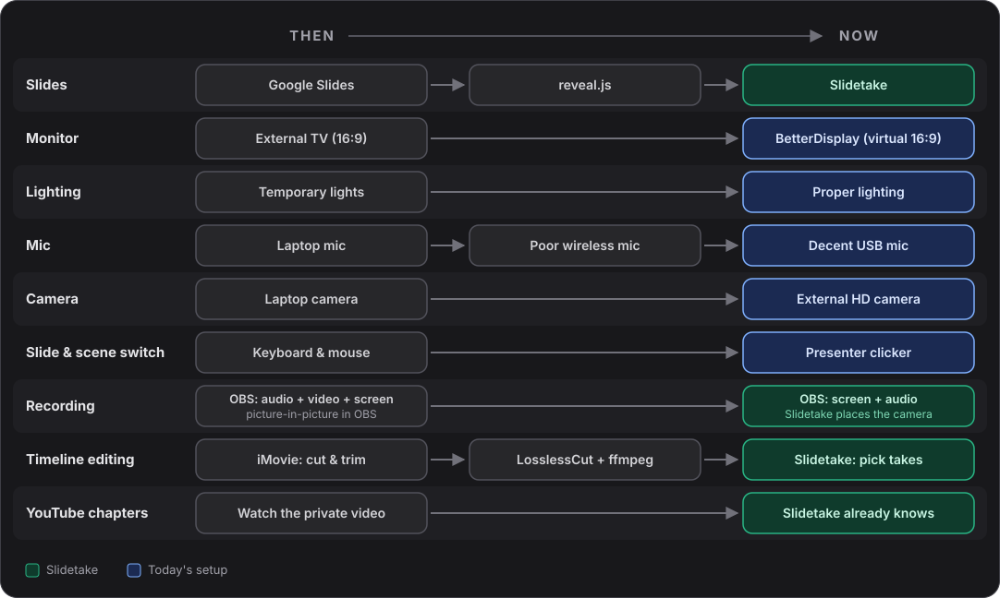

<!-- camera: on, full, on -->

# Building Slidetake

**From 2-3 days to a couple of hours per video.** How my recording setup evolved, and why the last step removed timeline editing altogether.

## ⏳ Where the days went

When I started, one [Building Wealth](https://sakthipriyan.com/building-wealth/videos/) video took **2-3 days**. Very little of that was talking.

<!-- steps -->
- **Making slides**, box by box
- **Fighting the setup** while recording
- **Cutting out mistakes** on a timeline
- **Going through YouTube again** to write the chapters and add info cards for related videos

## 🛤️ How the setup evolved



### 1. Google Slides and OBS

The first video: **Google Slides** recorded in **[OBS Studio](https://obsproject.com)**, with my webcam as a picture-in-picture.

<!-- steps -->
- A poor wireless mic
- Temporary lights
- Every fumble cut out on a timeline afterwards

### 2. Better gear

The cheapest improvement was hardware:

<!-- steps -->
- **Mic**: laptop, then a poor wireless one, then a decent USB one
- **Camera**: the laptop's, then an external HD one
- **Lighting**: temporary lights, then proper ones
- **A 16:9 screen**: an external TV, later a virtual display with **[BetterDisplay](https://github.com/waydabber/BetterDisplay)**
- Better videos straight away
- **No faster to produce**

### 3. Web-native slides: reveal.js

Google Slides couldn't give me what I wanted:

<!-- steps -->
- **Faster to make**: text is quick to write and to generate
- **On the website**: the deck beside the post it explains
- **A progress bar**: not a simple option in Google Slides
- **[reveal.js](https://revealjs.com)**: markdown in git, served from this site, a progress bar as a setting
- At work I'd been using **[Slidev](https://sli.dev)**, for the same reasons, before building **[Slidetake](https://slidetake.com)**

### 4. A presenter remote drives OBS

To stop touching the screen, I wired a Bluetooth presenter remote through reveal.js to OBS's WebSocket API. One button moves the slides, another switches the scene:

| Scene | What the viewer sees |
|---|---|
| **Screen Only** | the slides, full frame |
| **Video RB** | the slides, me bottom-right |
| **Video Only** | just me |

But the mistakes were still in the recording.

### 5. From iMovie to LosslessCut and ffmpeg

Editing in **iMovie** meant importing every recording into its library and re-encoding on export: slow, and heavy on storage. So I split the job:

<!-- steps -->
- **[LosslessCut](https://github.com/mifi/lossless-cut)**: mark the segments to keep, straight on the OBS file
- **[ffmpeg](https://ffmpeg.org)**: render the final video from those timestamps
- Then **YouTube**: watch it again to type the chapters and add info cards

**Less storage, faster editing**, and scriptable. But I still **watched the whole recording** to find each mistake.

## 💡 The slide is the timeline marker

Almost every cut was at a **slide boundary**. Every chapter started at a **section**. The deck already knew both.

<!-- steps -->
- Log each slide against OBS's recording clock
- Going back to a slide records a new **take**
- Picking the best take of each slide **is** the edit
- The section headings **are** the chapters

> **No timeline to scrub: the timeline is the list of slides.**

## 🎬 Slidetake

**Write in markdown. Present on a spatial canvas. Record without timeline editing.**

### Write: a text file

A deck is one markdown file: each heading is a card, laid out as a map. **O** zooms out to the whole talk, and a progress bar fills as you go.

Because it's text, **AI drafts it** from a blog post or a book chapter, and I iterate on it like code. `npx slidetake deck.md` reloads the deck on every save.

### Record: the deck drives OBS

<!-- camera: 40%, full, on -->

**● Record** starts OBS, follows the slides and stops at the end. The three OBS scenes became one comment:

```md
### Record: the deck drives OBS
<!-- camera: 40%, full, on -->
```

OBS now records just the screen and audio: the camera is part of the deck, so Slidetake places it, not OBS. This slide just did it: large in the corner, full screen, back. Stumble? Press **←** and say it again. Recording never stops.

### Review: pick, don't scrub

Every slide's takes, the last one picked by default. Slidetake writes:

<!-- steps -->
- A **frame-exact ffmpeg command** that keeps only the picked takes
- **Chapters**, timed to the final cut
- A **publish pack**: title, description, chapters, links, tags

One command, and the video is ready to upload.

## 📊 What changed

| | When I started | With Slidetake |
|---|---|---|
| **Slides** | Google Slides | markdown, drafted with AI |
| **On the website** | a link to Google | a page on the site |
| **Layout changes** | by hand, mid-recording | a `camera:` comment |
| **Mistakes** | found in the recording | press ←, say it again |
| **Cut points** | by watching | logged while recording |
| **Chapters** | typed by hand | from the headings |
| **Time per video** | 2-3 days | a couple of hours, the aim |

## 📚 Examples: Building Wealth

These [Building Wealth](https://sakthipriyan.com/building-wealth/slides/) decks are Slidetake decks, drafted from a blog post or a book chapter:

| Deck | Made from |
|---|---|
| **[FX Retail via Bharat Connect](https://sakthipriyan.com/building-wealth/slides/fx-retail-via-bharat-connect-private-bank-speed-at-public-bank-rates/)** | a blog post, with its screenshots, a chart and a diagram |
| **[Irish ETFs vs US ETFs](https://sakthipriyan.com/building-wealth/slides/irish-etfs-vs-us-etfs-what-indian-investors-should-buy/)** | a book chapter |
| **[Selecting the Global Indexes](https://sakthipriyan.com/building-wealth/slides/selecting-the-global-indexes-irish-etfs-for-indian-investors/)** | a book chapter, with fund tables |
| **[State of the 1 Portfolio, October 2026](https://sakthipriyan.com/building-wealth/slides/state-of-the-1-portfolio-october-2026/)** | a monthly portfolio post, with ECharts charts |

## 🔜 What's next: info cards and end screens

One manual step is left on YouTube: the **info cards** for related videos during the talk, and the **end screen** at the end.

A deck can name the videos it points to, and on which slide, so these can come from the deck too.

## 🌐 Try it

<!-- camera: on, full -->

| Where | |
|---|---|
| **[slidetake.com](https://slidetake.com)** | write, view and share in the browser |
| **Your computer** | `npx slidetake deck.md` |
| **Your website** | `slidetake.js`, or `engine: slidetake` in [hugo-continuum](https://github.com/sakthipriyan/hugo-continuum) |

Open source, Apache 2.0: **[github.com/slidetake/slidetake](https://github.com/slidetake/slidetake)**
